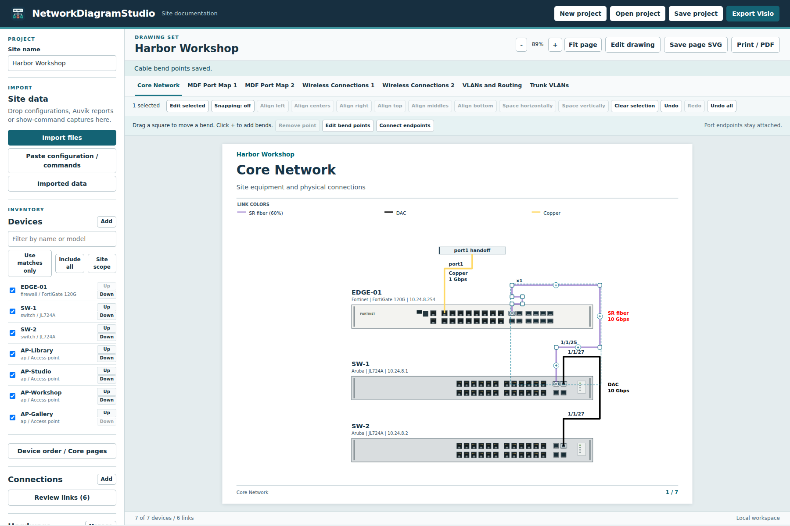
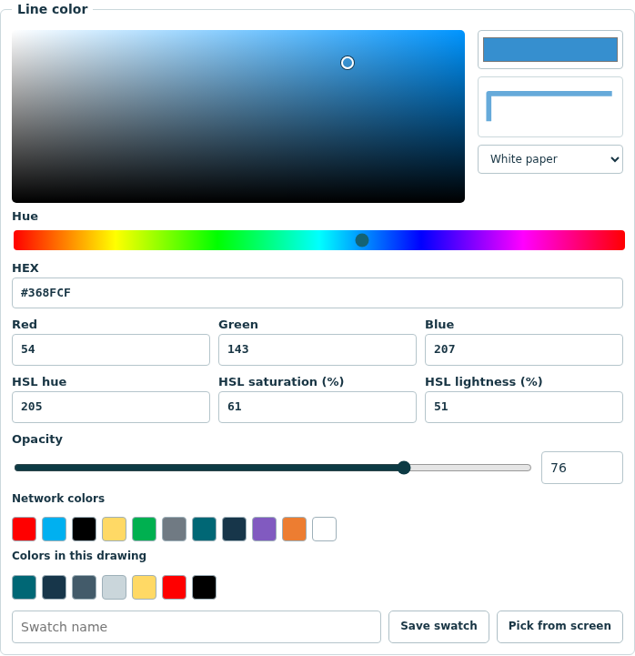

<p align="center"></p>
<h1 align="center">NetworkDiagramStudio</h1>
<p align="center">Build editable site network diagrams from switch and firewall configurations, Auvik reports, and your own hardware stencils.</p>
<p align="center"><a href="#download">Download</a> | <a href="#getting-started">Get started</a> | <a href="#features">Features</a> | <a href="#screenshots">Screenshots</a> | <a href="#updates-and-settings">Updates</a> | <a href="#development">Development</a></p>
<p align="center"></p>

## Features

Network engineers can use the Windows application or the offline browser edition to turn site records into an editable drawing set.

- Import supported configurations, Auvik XLSX/CSV reports and show-command captures. Enable each file and choose identity, ports, links, VLANs, routes and bridges separately.
- Generate core topology with documented WAN handoffs, switch port maps, wireless connections, VLAN and routing records, and a site-specific trunk matrix showing native, tagged and excluded VLANs. Port maps separate the endpoint assignment from configured mode and operational state.
- Order devices with Up/Down buttons or drag and drop. Choose equipment for named Core Network pages or let the app fit the selected hardware automatically, including APs.
- Prefer straight or simple orthogonal core cables, with consistent exterior lanes when needed and jumps at crossings. Nearby device titles move to accommodate clearer routes. Core and wireless sheets include an editable link-color legend. Cross-page links identify the other sheet.
- Import supported picture and vector Visio masters from files or recursively scanned folders. Search master names directly in the picker, or click a device to search local stencils. Artwork and mapped jacks retain matching transforms.
- Drag mapped port markers; align a selected row or column and distribute ports evenly. The sourced native hardware catalog includes model-specific faceplates, declared stack members and chassis modules.
- Zoom, pan and Fit page. In Edit drawing, box-select or Shift/Ctrl-click items, move them with the mouse or arrow keys, align edges or centers, and distribute spacing. Configure grid snapping and alignment guides. Double-click text to type directly on the diagram; double-click other elements for properties. Ctrl+Z, Ctrl+Shift+Z and Undo all apply to project changes. Alt-drag selects native panel details.
- Edit cable bends directly, reconnect either end to a selected device/port, and customize line color/opacity or text color with a spectrum, numeric color formats, presets and saved swatches. Legends include only the styles used on each sheet.
- Zoom into port mapping, box-select sockets, move a group with the mouse or arrow keys, and align or distribute the selection. Port detail tables support numeric order, consecutive grouping and optional empty-record filtering.
- Save and reopen projects, export editable Visio drawings, save the current page as SVG, or print the drawing set to PDF.

## Screenshots

**Switch port map**

<p align="center"></p>

**Wireless connections**

<p align="center"></p>

**Direct editing and alignment**

<p align="center"></p>

**Visual line color picker**

<p align="center"></p>

## Download

The releases index includes published previews. A pull request or local build may contain changes awaiting release validation. [GitHub releases](https://github.com/TechSavage1989/NetworkDiagramStudio/releases)

| Asset | Use |
| --- | --- |
| NetworkDiagramStudio.exe | Portable Windows x64 desktop edition. Place the executable in a writable folder and launch it there. |
| NetworkDiagramStudio-web.zip | Offline browser edition. Extract the ZIP and open NetworkDiagramStudio.html in a current desktop browser. |
| SHA256SUMS.txt | SHA-256 checksums for both assets. |

## Requirements

- The desktop edition targets Windows x64 with the Microsoft Edge WebView2 Runtime. The executable includes its .NET runtime.
- The browser edition needs a current browser with JavaScript modules, import maps and local file downloads. The bundled HTML opens directly from disk.
- Eligible legacy picture masters load locally. Other legacy binary artwork requires installed desktop Microsoft Visio on Windows. Supported XML and modern stencil/drawing/template formats import locally; macros are not executed. Raster artwork remains a replaceable image.

## Getting started

1. Launch the Windows executable or open the extracted HTML file.
2. Select **Open sample site** to explore the fictional Harbor Workshop network. Select a drawing tab to inspect its contents.
3. Select **New project** for your site. Enter the site name, then select **Import files** or **Paste configuration / commands**. Supply Auvik interface reports or supported operational captures for observed neighbors and link speeds.
4. Open **Review links** and resolve warnings. Select **Save project** to download the working project, then **Export Visio** to create the drawing set.

## How to use

- **Device scope.** **Site scope** selects devices with imported configurations and their directly linked APs. An inventory without configurations starts with all devices included. Filter by hostname or model, choose **Use matches only** or **Include all**, or set individual checkboxes. Select a device to edit its details and ports.
- **Order and pages.** Use **Up** and **Down**, or drag a device row above another device. **Device order / Core pages** creates named core sheets and assigns devices, leaves them on automatic sheets, or excludes them from the core. Equipment continues onto additional sheets when faceplates and cable clearances do not fit. Disabling **Include access points on automatic core pages** keeps automatic sheets focused on infrastructure. Choices are saved with the project.
- **Supplemental data.** **Imported data** lists imported configurations, Auvik files and show-command captures. Toggle the file or its categories. Assign a command capture to its local device if its prompt or filename does not identify it correctly. Changing included observations preserves manual corrections. Drop supported site-data files anywhere in the app. Captures are parsed locally and commands are never executed.
- **Physical links.** Review both endpoint ports, speed and media. A port's SFP capability alone does not establish whether an SR, LR or DAC module is installed.
- **Hardware.** Open **Hardware** and select **Manage** to import supported VSSX/VSDX masters, a front-view image, or a saved hardware pack. Recognized front views can match a model or SKU. Assign a front to a device to reuse it on matching models. **Map ports** shows existing jack markers and allows point placement or numeric coordinates. **Core faceplate scale** in device details adjusts size while retaining proportions. Save a hardware pack to carry artwork, model assignments and optic choices to another project. Use only artwork you are authorized to use and share.
- **Deliverables.** Use **Export Visio** for an editable drawing, **Save page SVG** for a single page, and **Print / PDF** for the entire set. For a reusable Visio stencil containing the hardware used in the current drawing, select **Hardware**, **Manage**, then **Export Visio stencil**. **Open project** restores a saved project for further changes.

The hardware reference lists the supported syntax, report types and layout limits. [Hardware and configuration support](docs/HARDWARE_SUPPORT.md)

## Drawing and port alignment

Enable **Edit drawing**, then drag an item to move it. Shift-click adds or removes items from the selection. Alignment tools support left, right, top, bottom, horizontal centers and vertical middles; spacing tools retain the outside items and equalize the gaps. Hold Space while dragging to pan. Double-click an item or choose **Edit selected** for its text and style. Alt-drag moves a native panel detail independently. Cables retain their glued ports when edited.

In **Hardware**, choose **Map ports**. Drag a rectangle over sockets to select them, or select ports in the list. Shift adds ports and Ctrl toggles them. Drag a selected marker to move the group. Use **Align row**, **Align column** or equal spacing relative to the current port. Select one row or column when distributing sockets. Zoom with the wheel or the zoom buttons, choose **Fit device**, and hold Space or the middle mouse button to pan. Arrow keys move the selected ports one screen pixel, Shift moves ten and Ctrl moves one tenth. **Undo port change** or Ctrl+Z restores the previous mapping. Use **Place port** to add a socket at a clicked position.

Select **Port map options** while viewing a port-map sheet to choose compact or expanded tables, one row per interface or consecutive matching groups, and whether to repeat the faceplate on continued pages. Compact tables and first-page-only faceplates reduce the page count by default. Tables use numeric member/slot/port order and wrap long details. Choose all records, hide records without assignment details, or show only records with a peer/description. The table filter leaves the physical faceplate intact.

Double-click text to edit it directly on the diagram. Enter saves and Escape cancels. Double-click other elements to open their properties. In **Edit drawing**, drag a rectangle around items; Shift adds items and Ctrl toggles them. Drag the selected group or nudge it with arrow keys. Shift multiplies the configured step by ten; Ctrl divides it by ten.

The inline text editor includes a color chooser. **Text options** opens the full visual picker, text content, size, weight and alignment. Text colors apply to titles, port labels, legends and editable native stencil text, and are retained in projects, SVG and Visio exports.

**Snapping** configures grid spacing, alignment distance and alignment targets. Snapping starts off. Enable grid snapping, alignment guides, or both, and choose device edges/centers, other object edges or cable points. Press Alt after starting a drag to bypass snapping. Arrow-key nudges always use their exact step.

**Undo**, **Redo** and **Undo all** operate on the current project's available session history, including endpoint changes and port mappings. Ctrl+Z and Ctrl+Shift+Z work outside typing fields; typing fields retain their normal text undo. Up to 200 actions are retained. Undo all returns through the available actions, and Redo reapplies them in order. Loading a project starts a new history. Port mapping also has scoped **Redo port change** and **Undo all port changes**.

In **Edit drawing**, select a cable. Drag a square handle to move a bend, click a plus control to add a detour, or select a bend and choose **Remove point** or press Delete. **Edit bend points** offers numeric coordinates and add/remove controls. Arrow keys also nudge a selected bend; Shift moves farther and Ctrl uses a fine step. **Connect endpoints** selects a device and physical port for each end and recalculates the route. It retains the cable's styling and checks occupied sockets.

**Edit selected** opens the line color spectrum, hue slider, HEX/RGB/HSL values, opacity, network presets, colors in the drawing, recent colors and named swatches. The system color picker is also available; supported browsers can sample the screen. The legend reflects only the link styles used on that sheet. Crossings show arc hops with clearance, and the native Visio export includes arc-jump settings.

## Updates and settings

The Windows edition checks its public GitHub feed at startup, every five minutes while online, and when the window regains focus after two minutes. **Check updates** runs a manual check and shows progress. The result identifies both the installed and latest published versions. A local build ahead of the feed is identified explicitly. **Update details** provides the last timestamp, HTTP result and a copyable report. A lookup times out after 25 seconds; manual retries bypass transient automatic retry delays while respecting GitHub rate-limit pauses. **Download** retrieves and verifies an offered executable. **Install and restart** is a separate decision. Save your project before restarting.

Windows stores its WebView profile, release cache, staged update and retained rollback copy under **%LOCALAPPDATA%\NetworkDiagramStudio**. Projects and exports go to the location selected in the save dialog. The browser edition updates by replacing its extracted HTML with a newer download. Site inputs are parsed locally. Saved project files and drawings can contain hostnames, addressing and the artwork you imported.

## Troubleshooting

- **Missing ports or uncertain topology.** Import the corresponding device configurations and interface reports. Correct conflicting neighbors or unknown port mappings under **Review links** or **Hardware**.
- **Complex or legacy artwork.** Use the included PowerShell converter with installed desktop Visio. Use **-List** to see master names. Use **-HardwarePack** and **-MasterNames** to render selected masters to a local hardware pack, including vector-only artwork the browser cannot import directly. Select a new output path, import the JSON under **Hardware**, then map its ports.
- **No update offered for a manually supplied build.** A candidate is available through the updater only after it is published in the release feed. Compare the installed and latest published versions in **Update details**. A failed connection can be retried with **Check updates**.
- **Desktop runtime unavailable.** Install the Microsoft Edge WebView2 Runtime through your normal Windows software process, or open the portable browser edition.

## Development

Run these commands from the repository root using Node.js 22 or newer. The standalone browser build requires no package installation.

```sh
node scripts/check-repo.mjs
node --test
node scripts/build-web.mjs
```

Open **dist/NetworkDiagramStudio.html** after the build. To publish the Windows executable, run the following in PowerShell with the .NET 8 SDK installed.

```powershell
./scripts/build-windows.ps1
python scripts/package-release.py
```

[Contributor guide](AGENTS.md) · [Development handoff](DEVELOPMENT_HANDOFF.md) · [Release notes](docs/releases/0.1.0-preview.8.md) · [Third-party notices](docs/THIRD_PARTY_NOTICES.md)
