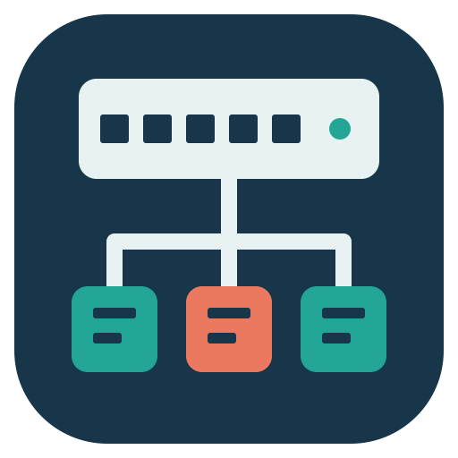
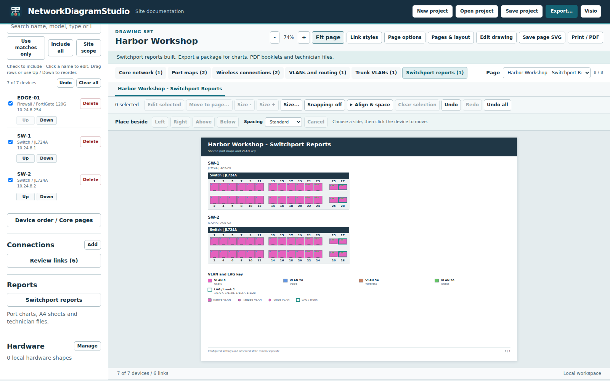
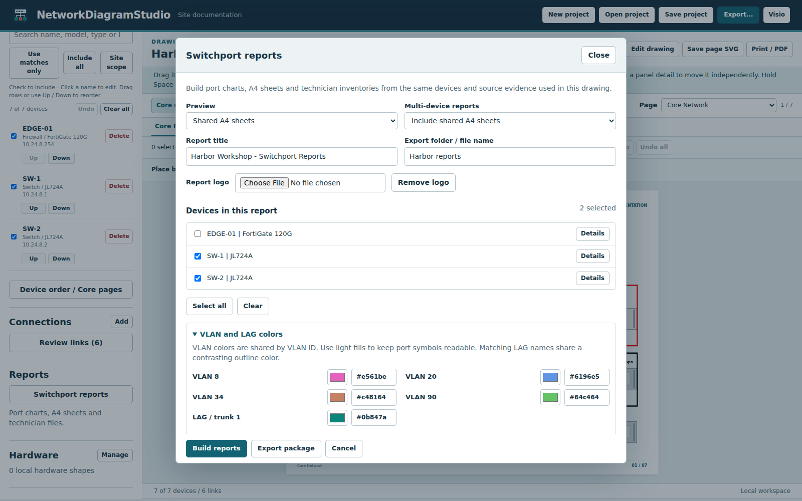
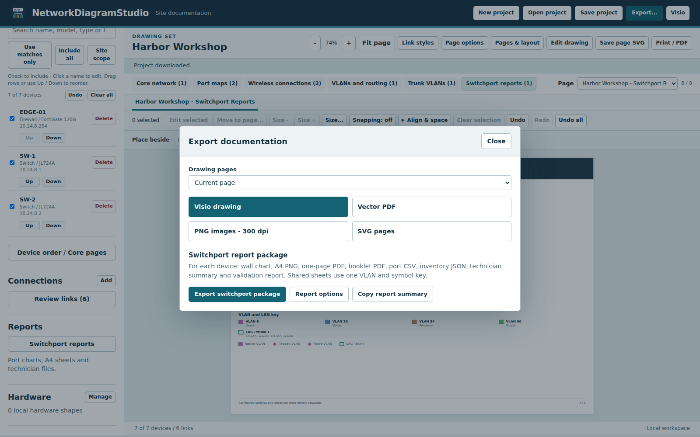

<p align="center"></p>
<h1 align="center">NetworkDiagramStudio</h1>
<p align="center">Build editable network diagrams, switchport charts and technician reports from local site data.</p>
<p align="center"><a href="#download">Download</a> | <a href="#getting-started">Get started</a> | <a href="#features">Features</a> | <a href="#screenshots">Screenshots</a> | <a href="#updates-and-settings">Updates</a> | <a href="#development">Development</a></p>
<p align="center"></p>

## Features

Network engineers can use the Windows application or the offline browser edition to turn site records into an editable drawing set.

- Build Switchport Diagram Builder reports inside the same project: wall charts, A4 sheets and complete inventory booklets, with native/tagged/voice VLAN symbols, LAG outlines, stack markers and readable numbers outside the ports.
- Export each device's eight-file report package, shared multi-device sheets, vector PDF, 300 dpi PNG, SVG and editable Visio. Keep one shared VLAN/LAG palette, report title, optional logo, serial numbers, asset tags and notes.
- Open existing Switchport Diagram Builder workspaces and supported unencrypted RouterOS backups. Keep supplementary observations independently selectable and separate from configuration intent.
- Navigate large drawing sets by page group and page picker. Moving equipment reroutes affected drawings with short local paths, nearby outside approaches and cable spacing based on painted line thickness.

- Recognize shared Cisco 9500/3560-E and Aruba 6000/6100 family layouts when a complete configuration identifies the geometry but omits its SKU. Confirm exact models and removable modules in Device details. See the [hardware research and coverage notes](docs/HARDWARE_RESEARCH_22.md).
- Import supported configurations, Base64 SonicWall EXP settings, Auvik XLSX/CSV reports and show-command captures. Enable each file and choose identity, ports, links, VLANs, routes and bridges separately.
- Add 21 device roles, including servers, hypervisor hosts, virtual machines, HCI nodes, storage, phones, workstations, printers, cameras and controllers. Recognize 43 common server/storage/platform families; retain custom models, actual interface records and user stencils.
- Generate core topology with documented WAN handoffs, switch port maps, wireless connections, VLAN and routing records, and a site-specific trunk matrix showing native, tagged and excluded VLANs. Trunk matrices measure headings and rows to fit more columns and VLANs before continuing onto another page. Port maps separate the endpoint assignment from configured mode and operational state.
- Order devices with Up/Down buttons or drag and drop. Choose equipment for named Core Network pages or let the app fit the selected hardware automatically, including APs. Automatic core pages try tighter padding, wider cable-label clearance and a narrower connection/module sidebar before continuing. Device order is preserved, and overflow fills the following sheet without dropping equipment or connections. Chassis and stacks keep a common faceplate width and their proportions instead of shrinking individually; explicit user sizing is retained. Oversized native stacks continue by member range with their original ports and off-page links. Failed rebuilds retain the last valid drawing; rejected device edits leave inventory unchanged.
- Prefer straight or simple orthogonal core cables, with consistent exterior lanes when needed and jumps at crossings. Parallel cables keep a clear visible gap on evenly spaced tracks, every cable stays clear of all four sides of each device, and lanes are reordered when that removes crossings. Supported modular chassis route through the center gap or a clear outer channel, turning only within the connected module instead of crossing adjacent modules or management bays; leads can also leave through an empty slot or the empty second management bay toward their peer. When a cable caption cannot sit beside a dense bundle, it sits on the cable itself with a white background instead of spreading every line apart. Nearby device titles move to accommodate clearer routes. Core and wireless sheets include an editable link-color legend. Cross-page links identify the other sheet.
- Import supported picture and vector Visio masters from files or recursively scanned folders. Search master names directly in the picker, or click a device to search local stencils. Embedded connection points retain their names and positions, including unnamed points and grouped/rotated artwork. Duplicate names stay as separate editable points instead of being merged.
- Drag mapped port markers; align a selected row or column and distribute ports evenly. The sourced native hardware catalog includes model-specific faceplates, declared stack members and chassis modules. Confirm member and module models directly in Device details.
- New drawings use **Dynamic / Fit all**. Core pages grow to keep all assigned devices together at a common readable scale, including labels, cables and objects moved beyond the original edges. Choose a fixed drawing size when desired, and choose separate print paper in **Page options**. Printing fits each complete drawing page onto the chosen sheet without resizing the editable devices.
- Zoom, pan and Fit page. In Edit drawing, box-select or Shift/Ctrl-click items. Shift-drag locks movement to the initial horizontal or vertical direction. The **Place beside** row stays visible while editing. Choose Left, Right, Above or Below, click the device to move if none is selected, then click the reference device. Compact, Standard and Extra room set predictable gaps; blocked placements stay near the reference or report that there is no space. The reference devices and current zoom stay fixed. Use **Size - / Size +** for quick resizing, and **Size...** for selected items, one page or all pages. **Move to page** places selected devices on a named page with off-page indicators. **Align & space** holds alignment and distribution tools. Configure grid snapping and alignment guides. Double-click text to type directly on the diagram; double-click other elements for properties. Ctrl+Z, Ctrl+Shift+Z and Undo all apply to project changes. Alt-drag selects native panel details.
- Select cable type and link speed in line properties, the connection editor or a legend swatch. Legend choices update associated connection records across the drawing. Choose Copper, generic/MMF/SMF fiber, SR/LR/ER/ZR, DAC variants, AOC/AEC, coaxial or serial; use speed presets or enter custom values. Captions and active legends follow the selected type.
- Select cables using a wider invisible target around the painted line. Logical VLAN/aggregate observations remain in the data tables and connection review without appearing as duplicate physical cables. Edit cable bends directly, reconnect either end to a selected device/port, and customize line color/opacity or text color with a visual selector, HEX field and standard swatches. Link styles shares colors and titles/descriptions between cables and their legend entries. Legends include only the styles used on each sheet. Automatic cables and their color keys use a consistent standard thickness; exported Visio line widths are explicit and editable.
- Zoom into port mapping, box-select sockets, move a group with the mouse or arrow keys, and align or distribute the selection. Port maps keep a shared hardware scale and plain port numbers in black or white, whichever reads against the faceplate. The default booklet follows the Switchport Diagram Builder sheet on the app's own faceplates: a dark bar per device, each jack filled in its native VLAN color with a dot per tagged VLAN, a diamond for the voice VLAN and its LAG outline, then a VLAN key, Trunks / LAGs and port descriptions. Each switch gets a Port inventory table (ports, description, mode, native, tagged VLANs, LAG, voice, link and connected device), where consecutive ports with identical settings share a row. VLAN and LAG colors match the Switchport reports. The combined layout keeps its role-colored assignment matrix. Larger stacks continue by member range. Expanded tables, individual rows and optional empty-record filtering remain available.
- Show manufacturer/model and available MAC addresses on wireless AP captions and other device diagrams. Edit device and interface addresses through readable form fields; single addresses remain visible; long lists become a compact count. Full address lists remain in Device details and the optional information panel.
- Save and reopen the complete project, including report selections, colors, metadata, imported evidence and drawing edits.
- Keep complete diagram captions with measured wrapping in both SVG and Visio. Port modules use editable gray optic faces with dark sockets and dark DAC ends with a horizontal insert, matching the Configuration Inspector style. Framed module keys expand or continue onto a module sheet; duplicate wording such as Port port1 is avoided.
- Use the Visio-reference presentation with Calibri, a left connection/module key, nearby device labels and compact WAN/circuit cards. Circuit cards fit the actual stack width, use extra rows on narrow devices and retain complete provider/gateway text. Routes use available space inside the stack width when port orientation and clearances permit. Configure page-number visibility, starting values, padding and format.

- Rename tabs, choose devices for named network/report pages, scale drawings/devices/text globally or independently, and customize the information panel with VLANs, addresses, routes and notes in **Pages & layout**. Built-in connectors use shared proportions across chassis and stacks. See the [layout guide](docs/FLEXIBLE_LAYOUT.md).

## Screenshots

**Document each switch with VLAN-marked faceplates, trunks and a port inventory.**
<p align="center"></p>

**Build shared switchport sheets with readable port numbers and one VLAN key.**
<p align="center"></p>

**Choose report devices, metadata and shared colors in one place.**
<p align="center"></p>

**Export the drawing or a complete technician report package.**
<p align="center"></p>

## Download

The releases index includes published previews. A pull request or local build may contain changes awaiting release validation. [GitHub releases](https://github.com/TechSavage1989/NetworkDiagramStudio/releases)

| Asset | Use |
| --- | --- |
| NetworkDiagramStudio.exe | Portable Windows x64 desktop edition. Place the executable in a writable folder and launch it there. |
| NetworkDiagramStudio-web.zip | Offline browser edition. Extract the ZIP and open NetworkDiagramStudio.html in a current desktop browser. |
| SHA256SUMS.txt | SHA-256 checksums for both assets. |

## Requirements

- The desktop edition targets Windows x64 with the Microsoft Edge WebView2 Runtime. The executable includes its .NET runtime.
- The browser edition needs a current browser with JavaScript modules, import maps and local file downloads. The bundled HTML opens directly from disk.
- Eligible legacy picture masters load locally. Other legacy binary artwork requires installed desktop Microsoft Visio on Windows. Supported XML and modern stencil/drawing/template formats import locally; macros are not executed. Raster artwork remains a replaceable image.

## Getting started

1. Launch the Windows executable or open the extracted HTML file.
2. Select **Open sample site** to explore the fictional Harbor Workshop network. Select a drawing tab to inspect its contents.
3. Select **New project** for your site. Enter the site name, then select **Import files** or **Paste configuration / commands**. Supply Auvik interface reports or supported operational captures for observed neighbors and link speeds.
4. Open **Review links** and resolve warnings. Select **Save project** to download the working project, then **Export Visio** to create the drawing set.

## How to use

- **Device scope.** **Site scope** selects devices with imported configurations and their directly linked APs. An inventory without configurations starts with all devices included. Filter by hostname or model, choose **Use matches only** or **Include all**, or set individual checkboxes. Select a device to edit its details and ports.
- **Order and pages.** Use **Up** and **Down**, or drag a device row above another device. **Device order / Core pages** creates named core sheets and assigns devices, leaves them on automatic sheets, or excludes them from the core. The app tries several spacing arrangements before continuing equipment onto another sheet, keeping text readable and cable labels clear. Named groups can continue onto additional sheets when needed, with their assignments and off-page connection preferences retained. Deliberate position and size edits remain authoritative. Disabling **Include access points on automatic core pages** keeps automatic sheets focused on infrastructure. Choices are saved with the project.
- **Supplemental data.** **Imported data** lists imported configurations, Auvik files and show-command captures. Toggle the file or its categories. Assign a command capture to its local device if its prompt or filename does not identify it correctly. Changing included observations preserves manual corrections. Drop supported site-data files anywhere in the app. Captures are parsed locally and commands are never executed.
- **Inventory roles and platforms.** **Add device** includes servers, hypervisor hosts, VMs, HCI, storage, phones and other endpoints. Model suggestions include common Dell, HPE, Lenovo, Cisco, Supermicro, storage and virtualization families. A recognized model can suggest a new device role and vendor; an explicitly selected role remains authoritative. **Platform / technology** records ESXi, Hyper-V, Proxmox, AHV, HyperCore or a custom platform independently of the physical model.
- **Physical links.** Review both endpoint ports, speed and media. A port's SFP capability alone does not establish whether an SR, LR or DAC module is installed.
- **Hardware.** Open **Hardware** and select **Manage** to import supported VSSX/VSDX masters, a front-view image, or a saved hardware pack. Recognized front views can match a model or SKU. Assign a front to a device to reuse it on matching models. **Map ports** shows existing jack markers and allows point placement or numeric coordinates. **Core faceplate scale** in device details adjusts size while retaining proportions. Save a hardware pack to carry artwork, model assignments and optic choices to another project. Use only artwork you are authorized to use and share.
- **Local stencil search.** Click a diagram device to open its stencil picker. **Search selected vendor files** filters files from folders you already selected by vendor-related filenames. **Search all selected folders** searches the full selected collection. Neither button searches the internet. Empty results explain whether folders or matching files are missing.
- **Deliverables.** Open **Export** and choose the current page, current page group or all pages, then Visio, vector PDF, 300 dpi PNG or SVG. The quick **Visio**, **Save page SVG** and **Print / PDF** controls remain available. For a reusable Visio stencil containing the hardware used in the current drawing, select **Hardware**, **Manage**, then **Export Visio stencil**. **Open project** restores a saved project for further changes.

The hardware reference lists the supported syntax, report types and layout limits. [Hardware and configuration support](docs/HARDWARE_SUPPORT.md) · [Server, storage and virtualization catalogue with official references](docs/ENDPOINT_HARDWARE.md). Endpoint family recognition does not establish installed NIC/HBA sockets. Map the actual adapters with interface inventory and a verified stencil. The physical catalog has 314 verified bank profiles covering 423 model identifiers, including new UniFi, Netgate and PA-455 layouts and corrected PA-415 combo sockets. Unknown models have editable base drawings for every inventory role, with boundary connections until their actual ports are mapped.

VLANs and routing are grouped under each device's header. Complete device sections share a page when they fit; larger sections continue with a repeated device header and column headings. Captions remain editable and are preserved when devices are reordered.

The Connection Types and Port Modules sidebar can shrink in width and spacing when the core diagram needs more room. Cable and legend line weights remain identical, captions wrap in full, and readable font sizes are retained. Explicit sidebar position/size edits preserve its original width.

The app disables browser right-click menus so browser navigation and inspection commands do not cover the drawing. Keyboard editing shortcuts remain available.

## Switchport reports

Open **Switchport reports** in the sidebar. Select the switches or firewalls, choose shared A4 sheets, separate sheets, wall charts or full booklets, then select **Build reports**. The new **Switchport reports** page group appears beside the network views. Report settings, device details, colors, logo and selected observations are saved in the normal project file and use the same Undo history.

**Device details** includes per-device, stack-member and module names, serial numbers, asset tags and notes. Choose supported models and installed cards in the existing hardware fields. Unsupported or contradictory hardware remains qualified; the report does not invent sockets. Unknown models and oversized unreadable layouts produce a validation result with the available inventory data.

**VLAN and LAG colors** uses one color per VLAN ID and one outline per normalized LAG name across the selected workspace. The key retains different names used for the same VLAN ID. Native VLAN, tagged circles, voice diamonds, LAG outlines, stack links, disabled ports and unknown/explicitly absent native VLANs remain distinct. Colors do not establish connectivity.

**Supplementary observations** accepts Auvik workbooks and operational captures for selected devices. Each source can be disabled or removed without rewriting configured VLANs, administrative state or hardware. Ordinary topology imports remain available under **Imported data**. An existing **.spworkspace.json** file can be opened or added through **Import files**; only normalized inventory and evidence are retained in a saved NetworkDiagramStudio project.

**Export switchport package** creates these files for every supported device: wall-chart.png, a4-one-page.png, a4-one-page.pdf, a4-booklet.pdf, port-map.csv, inventory.json, technician-summary.txt and validation-report.txt. Multi-device exports add shared A4 diagram/booklet PDFs, sheet PNGs and workspace layout, palette and export records. Selected supplementary sources add their own CSV/JSON records. The Windows edition remembers the chosen output location and writes a new folder without overwriting earlier reports; the offline browser downloads a ZIP. The export dialog can open the latest native chart, PDF or folder and copy its summary. A failed export keeps the last successful result available.

Reports use A4 landscape and readable measured typography. Dense devices can use compact proportional geometry; unusually large inventories or legends continue in booklets or return a clear capacity result. A failed visual format does not discard another device's successful package or its inventory and validation files. See the [integration and verification reference](docs/SWITCHPORT_INTEGRATION.md) for supported syntax and deliberate differences from the standalone application.

## Drawing and port alignment

Enable **Edit drawing**, then drag an item to move it. Shift-click adds or removes items from the selection. Alignment tools support left, right, top, bottom, horizontal centers and vertical middles; spacing tools retain the outside items and equalize the gaps. Hold Space while dragging to pan. Double-click an item or choose **Edit selected** for its text and style. Alt-drag moves a native panel detail independently. Cables retain their glued ports when edited. Hold Shift during a cable or bend drag to lock the dominant horizontal or vertical axis; release Shift to move freely. Grid and guide snapping respect the locked axis.

In **Hardware**, choose **Map ports**. Drag a rectangle over sockets to select them, or select ports in the list. Shift adds ports and Ctrl toggles them. Drag a selected marker to move the group. Use **Align row**, **Align column** or equal spacing relative to the current port. Select one row or column when distributing sockets. Zoom with the wheel or the zoom buttons, choose **Fit device**, and hold Space or the middle mouse button to pan. Arrow keys move the selected ports one screen pixel, Shift moves ten and Ctrl moves one tenth. **Undo port change** or Ctrl+Z restores the previous mapping. Use **Place port** to add a socket at a clicked position. Supported Visio imports populate existing connection points automatically. Unnamed points receive neutral Connection labels; map or rename these to actual interfaces when their identities are known. Unsupported or missing cached point coordinates produce an import error instead of silently dropping the points.

Port maps show numbered faceplates with native VLAN colors, a VLAN key, and link-state strips. Separate **Port Inventory** sheets list assignments and details. Use **Port map options** to select the combined layout, expanded tables, or one row per interface. Port lists use numeric member/slot/port order and wrap long details. The table filter leaves the physical faceplate intact.

Port-map hardware uses one common width across its sheets, preserving each chassis and stack member's proportions. The planner measures complete panels and tries bounded shared scale adjustments to reduce page count. It favors the larger scale when both arrangements use the same number of pages. Oversized native stacks continue by member range with their local port details, and long tables can continue without repeating the artwork. Wireless sheets use the same principle and connect APs to their actual member. Change the **Port maps** or **Wireless** paper override in **Page options** to provide more space. Existing explicit size/position edits remain authoritative.

Double-click text to edit it directly on the diagram. Enter saves and Escape cancels. A rejected edit stays visible with an explanation so it can be corrected or cancelled. Double-click other elements to open their properties. In **Edit drawing**, drag a rectangle around items; Shift adds items and Ctrl toggles them. Drag the selected group or nudge it with arrow keys. Shift multiplies the configured step by ten; Ctrl divides it by ten.

The inline text editor includes a color chooser. **Text options** opens the compact color selector alongside text content, size, weight and alignment. Text colors apply to titles, port labels, legends and editable native stencil text, and are retained in projects, SVG and Visio exports.

**Snapping** configures grid spacing, alignment distance and alignment targets. Snapping starts off. Enable grid snapping, alignment guides, or both, and choose device edges/centers, other object edges or cable points. Press Alt after starting a drag to bypass snapping. Arrow-key nudges always use their exact step.

**Undo**, **Redo** and **Undo all** operate on the current project's available session history, including endpoint changes and port mappings. Ctrl+Z and Ctrl+Shift+Z work outside typing fields; typing fields retain their normal text undo. Up to 200 actions are retained. Undo all returns through the available actions, and Redo reapplies them in order. Loading a project starts a new history. Port mapping also has scoped **Redo port change** and **Undo all port changes**.

In **Edit drawing**, select a cable. Drag a square handle to move a bend, click a plus control to add a detour, or select a bend and choose **Remove point** or press Delete. **Edit bend points** offers numeric coordinates and add/remove controls. Arrow keys also nudge a selected bend; Shift moves farther and Ctrl uses a fine step. **Connect endpoints** selects a device and physical port for each end and recalculates the route. It retains the cable's styling and checks occupied sockets. Devices without a supplied port list offer **Custom port** so you can enter an actual interface name and connect at the device boundary.

**Edit selected** also includes **Cable type** and **Link speed**. Both offer presets and **Custom** fields; an imported value remains selectable without changing its spelling or units. Saving a type/speed edit updates the connection record, relevant core/wireless captions and used legend categories, with one undoable action. Manually edited bends, names and widths are retained when the endpoints stay the same. The selected type uses its configured shared style, while other link types remain independent.

**Edit selected** opens a visual color selector, HEX field, eleven standard colors and line opacity. Line, legend and text dialogs keep their default controls and save actions visible without scrolling at 1366 by 768 and larger. The legend reflects only the link styles used on that sheet. Crossings show arc hops with clearance, and the native Visio export includes arc-jump settings.

**Link styles** configures colors, opacity and separate titles/descriptions for connection captions and legend entries. Editing a cable color or a legend swatch updates all cables of that link type and their legends throughout the drawing. The legend editor also offers cable-type and speed presets plus Custom fields. Saving updates the actual associated links, captions and legend speed summary in one undoable action. Mixed values stay unchanged until explicitly replaced. Existing connections already in the destination type keep their own speeds. Custom captions, positions, bends and widths remain editable. Double-click a legend title to rename it directly. Text color is independent of cable color. Wireless connection captions show the port and speed without evidence-status wording.

**Pages & layout** provides page names, selected-device network/report pages, visible tabs, drawing and text scales, shared device scale, and a configurable information panel. Double-click a tab to open it. Clear **Use drawing defaults** to override that page. Choose **Add a page**, its type and devices to create a custom report; hide unwanted automatic pages with **Show this page**. Open device details for individual device scale, or **Edit drawing > Edit selected** for object and font sizes. The [layout guide](docs/FLEXIBLE_LAYOUT.md) describes inheritance and stencil behavior.

**Page options** separates **Canvas size** from **Print paper**. Dynamic / Fit all is the default for new drawings; existing explicit paper choices are retained. Choose **Match drawing (full-size PDF)** for the full canvas, or Letter, Legal, Tabloid, A5 through A1, or custom print dimensions (148 to 1500 mm) to fit each drawing page onto a printed sheet. Other documentation views retain their logical sections and connection banks.

The device list shows each name, model/type and management IP, with a **Delete** button beside each device. Drag a row onto another device to place it before that device, or use **Up / Down** to change its position. The order is saved with the project and can be undone. The checkbox includes or excludes a device from the drawing. **Clear all** confirms the total inventory, including filtered or excluded devices; **Undo** restores devices and their connections.

**Page options** also shows or hides page numbers, chooses their starting number and padding, and sets a format. Use {page} for the current number, {last} for the final number and {total} for the sheet count. The default is a two-digit number such as 01 / 07. These settings persist in the project.

Use **Core page** in **Device details** or **Device order / Core pages** to assign equipment to an existing page, create a dedicated page, or return it to automatic placement. Selecting any current layout page saves that sheet's device group as a named page, including a continued sheet. Existing group connection preferences are retained. Named pages can show all, some, or none of their off-page connection references.

Visio legend samples are editable lines. Each cable follows the matching legend line's color, opacity, weight, and pattern on its page. Matching lines across pages also share a document line style. The default cable and legend stroke is 3 pt.

In **Device details**, enter device **MAC address(es)** when known. Multiple addresses can be separated by commas; colon, hyphen and dotted forms are normalized. Expand **Edit ports** to add a port or edit its name, description, MAC address, role, link speed, and VLAN assignments. Device captions prefer the device address; an interface-only address retains its interface name. Wireless captions use the connected interface when no device address is available. Enter tagged VLAN IDs separated by commas. To rename or remove a connected port, edit or remove its connection first.

Select **Stack members and installed modules** in Device details to confirm hardware composition. Use 2920 slots A/B for J9731A or J9732A; supported 3560-E uplinks use X2-1/X2-2 with the installed X2 transceiver or TwinGig adapter. A file without an exact model declaration needs a confirmed Model selection or mapped stencil. [Hardware import coverage and manufacturer references](docs/HARDWARE_SUPPORT.md).

## Updates and settings

Help opens a polished update review with compact installed/available version labels, formatted release headings and bullets, download progress, verification status and a fixed action footer. Long notes scroll inside the review while the close and install controls stay visible. The install screen explains recovery and reminds you to save unsaved diagram changes before restarting. A compact notice appears only when a newer release is available. Automatic checks and verified download/rollback behavior are unchanged.

For mixed-size printing, retain the document paper sizes in your print/PDF settings. Physical printers and custom forms must support the selected sizes. Visio drawing dimensions and standard printer paper kinds are exported separately; select a matching printer form for custom sizes.

The Windows edition checks its public GitHub feed at startup, every five minutes while online, and when the window regains focus after two minutes. The update bar stays hidden until a newer release is detected, leaving the full editor height available. Open **Help** in the existing app header for **Check updates**, **Update details** and **Notices**. Manual checks show progress and their result in that dialog, including connection errors or an up-to-date result. The result identifies both the installed and latest published versions. A local build ahead of the feed is identified explicitly. **Update details** provides the last timestamp, HTTP result and a copyable report. A lookup times out after 25 seconds; manual retries bypass transient automatic retry delays while respecting GitHub rate-limit pauses. **Download** retrieves and verifies an offered executable. **Install and restart** is a separate decision. Save your project before restarting.

Windows stores its WebView profile, release cache, staged update and retained rollback copy under **%LOCALAPPDATA%\NetworkDiagramStudio**. Projects and exports go to the location selected in the save dialog. The browser edition updates by replacing its extracted HTML with a newer download. Site inputs are parsed locally. Saved project files and drawings can contain hostnames, addressing and the artwork you imported.

## Troubleshooting

- **A drawing disappears after adding equipment in an older build.** Ctrl+Z can restore the prior inventory/layout. Dynamic / Fit all grows around the selected equipment, reserves space between crowded cables for their captions, and expands wireless pages for complete labels. Fixed-paper core sheets can continue onto another page. A failed rebuild retains the last valid drawing; a rejected device save leaves the form open and preserves the accepted project.
- **Text needs more room.** Generated captions wrap instead of using ellipses. Increase an edited text box when its full contents cannot fit at a readable size.
- **Editing appears locked in preview.9.** Use Tab or Shift+Tab to focus **Save project**, then Enter to save accepted edits. Confirm the file exists before restarting with a newer build. Preview.10 fixes the detached text editor that could block selection after a rejected edit.
- **Missing ports or uncertain topology.** Import the corresponding device configurations and interface reports. Correct conflicting neighbors or unknown port mappings under **Review links** or **Hardware**.
- **Complex or legacy artwork.** Use the included PowerShell converter with installed desktop Visio. Use **-List** to see master names. Use **-HardwarePack** and **-MasterNames** to render selected masters to a local hardware pack, including vector-only artwork the browser cannot import directly. Select a new output path, import the JSON under **Hardware**, then map its ports.
- **No update offered for a manually supplied build.** A candidate is available through the updater only after it is published in the release feed. Compare the installed and latest published versions in **Update details**. A failed connection can be retried with **Check updates**.
- **Desktop runtime unavailable.** Install the Microsoft Edge WebView2 Runtime through your normal Windows software process, or open the portable browser edition.

## Development

Run these commands from the repository root using Node.js 22 or newer. The standalone browser build requires no package installation.

```sh
node scripts/check-repo.mjs
node --test
node scripts/build-web.mjs
```

Open **dist/NetworkDiagramStudio.html** after the build. To publish the Windows executable, run the following in PowerShell with the .NET 8 SDK installed.

```powershell
./scripts/build-windows.ps1
python scripts/package-release.py
```

[Contributor guide](AGENTS.md) · [Development handoff](DEVELOPMENT_HANDOFF.md) · [Release notes](docs/releases/0.1.0-preview.27.md) · [Third-party notices](docs/THIRD_PARTY_NOTICES.md)
