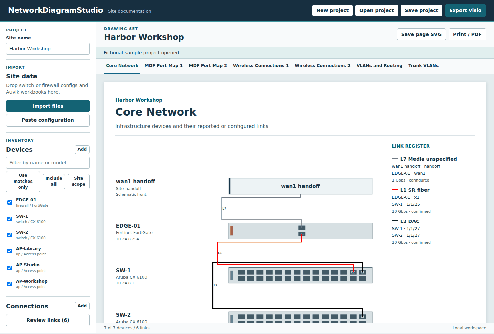
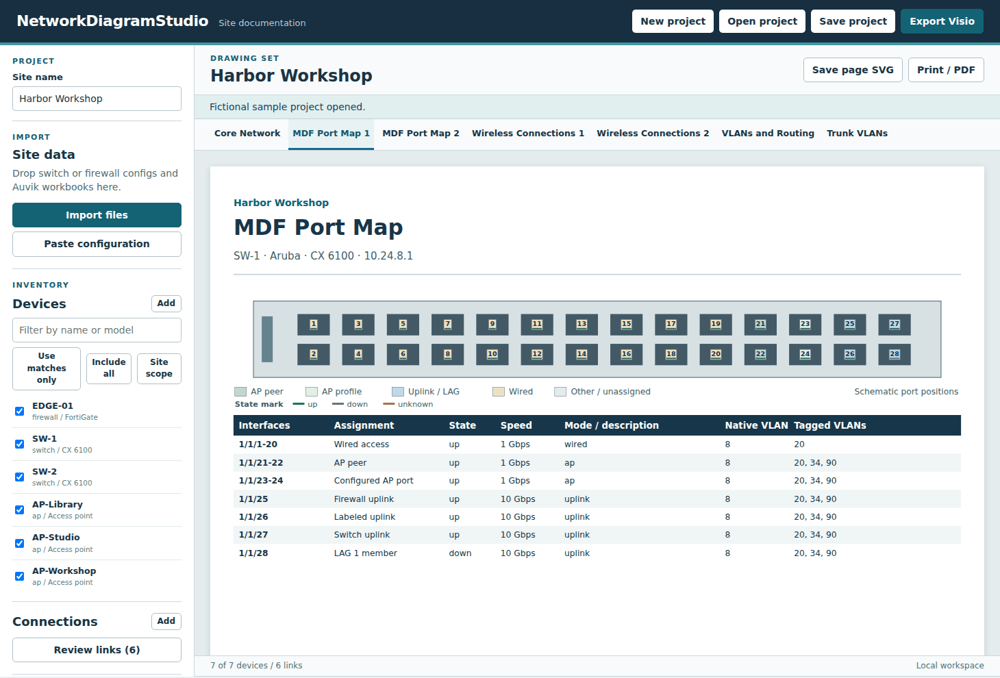
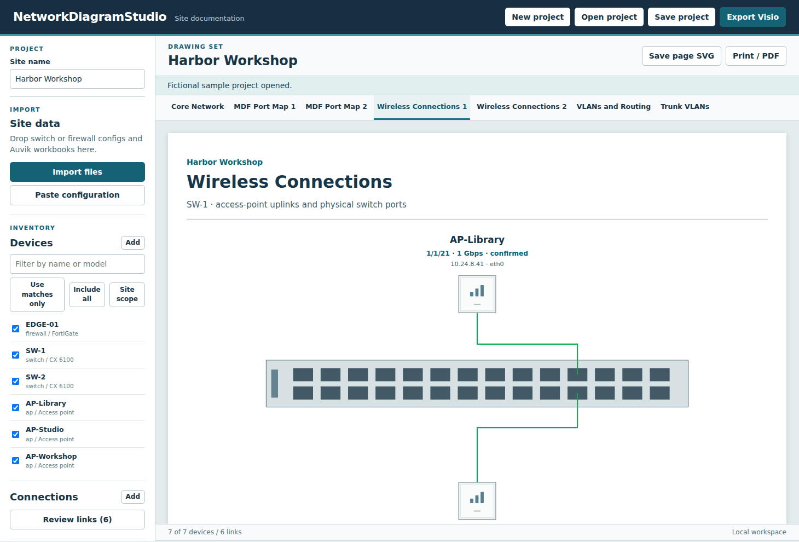

<h1 align="center">NetworkDiagramStudio</h1>
<p align="center">Build editable site network diagrams from switch and firewall configurations, Auvik reports, and your own hardware stencils.</p>
<p align="center"><a href="#download">Download</a> | <a href="#getting-started">Get started</a> | <a href="#features">Features</a> | <a href="#screenshots">Screenshots</a> | <a href="#updates-and-settings">Updates</a> | <a href="#development">Development</a></p>
<p align="center"></p>

## Features

Network engineers can use the Windows application or the offline browser edition to turn site records into an editable drawing set.

- Import supported configuration text and Auvik XLSX or CSV reports. Review the device inventory, select the site scope, and correct links before export.
- Generate core topology with documented WAN handoffs, switch port maps, wireless connections, VLAN and routing records, and a site-specific trunk matrix showing native, tagged and excluded VLANs. Port maps separate the endpoint assignment from configured mode and operational state.
- Use schematic devices or import compatible front-panel artwork, map physical jacks, and assign optics to documented links.
- Save and reopen projects, export editable Visio drawings, save the current page as SVG, or print the drawing set to PDF.

## Screenshots

**Switch port map**

<p align="center"></p>

**Wireless connections**

<p align="center"></p>

## Download

The releases index includes previews. If the first preview is still being validated, build it with the commands under Development. [GitHub releases](https://github.com/TechSavage1989/NetworkDiagramStudio/releases)

| Asset | Use |
| --- | --- |
| NetworkDiagramStudio.exe | Portable Windows x64 desktop edition. Place the executable in a writable folder and launch it there. |
| NetworkDiagramStudio-web.zip | Offline browser edition. Extract the ZIP and open NetworkDiagramStudio.html in a current desktop browser. |
| SHA256SUMS.txt | SHA-256 checksums for both assets. |

## Requirements

- The desktop edition targets Windows x64 with the Microsoft Edge WebView2 Runtime. The executable includes its .NET runtime.
- The browser edition needs a current browser with JavaScript modules, import maps and local file downloads. The bundled HTML opens directly from disk.
- Legacy binary VSS conversion requires installed desktop Microsoft Visio on Windows. VSSX import and VSDX export run inside the application.

## Getting started

1. Launch the Windows executable or open the extracted HTML file.
2. Select **Open sample site** to explore the fictional Harbor Workshop network. Select a drawing tab to inspect its contents.
3. Select **New project** for your site. Enter the site name, then select **Import files** or **Paste configuration**. Supply Auvik interface reports when you need observed neighbors and link speeds.
4. Open **Review links** and resolve warnings. Select **Save project** to download the working project, then **Export Visio** to create the drawing set.

## How to use

- **Device scope.** **Site scope** selects devices with imported configurations and their directly linked APs. An inventory without configurations starts with all devices included. Filter by hostname or model, choose **Use matches only** or **Include all**, or set individual checkboxes. Select a device to edit its details and ports.
- **Physical links.** Review both endpoint ports, speed and media. A port's SFP capability alone does not establish whether an SR, LR or DAC module is installed.
- **Hardware.** Open **Hardware** and select **Manage** to import compatible VSSX/VSDX masters, a front-view image, or a saved hardware pack. Recognized front views can match a device model or SKU. Assign a front to a device to reuse it on matching models. Use **Map ports** to line up each connector with the correct jack. Save a hardware pack to carry artwork, model assignments and optic choices to another project. Use only artwork you are authorized to use and share.
- **Deliverables.** Use **Export Visio** for an editable drawing, **Save page SVG** for a single page, and **Print / PDF** for the entire set. For a reusable Visio stencil containing the hardware used in the current drawing, select **Hardware**, **Manage**, then **Export Visio stencil**. **Open project** restores a saved project for further changes.

The hardware reference lists the supported syntax, report types and layout limits. [Hardware and configuration support](docs/HARDWARE_SUPPORT.md)

## Updates and settings

The Windows edition checks its public GitHub feed at startup, every five minutes while online, and when the window regains focus after two minutes. **Check updates** runs a manual check. **Download** retrieves and verifies an offered executable. **Install and restart** is a separate decision. Save your project before restarting.

Windows stores its WebView profile, release cache, staged update and retained rollback copy under **%LOCALAPPDATA%\NetworkDiagramStudio**. Projects and exports go to the location selected in the save dialog. The browser edition updates by replacing its extracted HTML with a newer download. Site inputs are parsed locally. Saved project files and drawings can contain hostnames, addressing and the artwork you imported.

## Troubleshooting

- **Missing ports or uncertain topology.** Import the corresponding device configurations and interface reports. Correct conflicting neighbors or unknown port mappings under **Review links** or **Hardware**.
- **Complex or legacy artwork.** Use the included PowerShell converter with installed desktop Visio. Use **-List** to see master names. Use **-HardwarePack** and **-MasterNames** to render selected masters to a local hardware pack, including vector-only artwork the browser cannot import directly. Select a new output path, import the JSON under **Hardware**, then map its ports.
- **Desktop runtime unavailable.** Install the Microsoft Edge WebView2 Runtime through your normal Windows software process, or open the portable browser edition.

## Development

Run these commands from the repository root using Node.js 22 or newer. The standalone browser build requires no package installation.

```sh
node scripts/check-repo.mjs
node --test
node scripts/build-web.mjs
```

Open **dist/NetworkDiagramStudio.html** after the build. To publish the Windows executable, run the following in PowerShell with the .NET 8 SDK installed.

```powershell
./scripts/build-windows.ps1
python scripts/package-release.py
```

[Contributor guide](AGENTS.md) · [Development handoff](DEVELOPMENT_HANDOFF.md) · [Release notes](docs/releases/0.1.0-preview.1.md) · [Third-party notices](docs/THIRD_PARTY_NOTICES.md)
