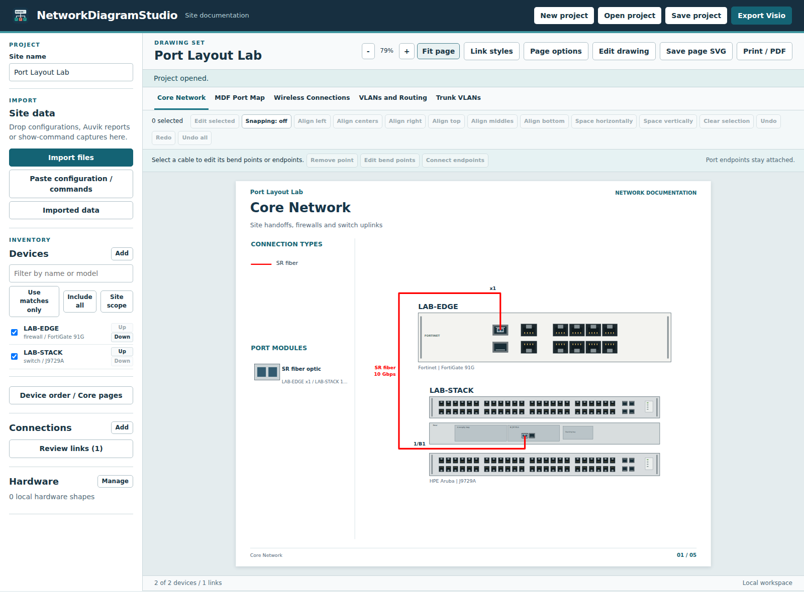

# Hardware and configuration imports

Import Auvik XLSX or CSV device, interface and route reports with saved configurations from the same site. A configuration supplies intended settings. Auvik supplies the port state, negotiated speed and reported neighbor at collection time. Check warnings and correct uncertain connections before exporting.

See [configuration-driven hardware coverage](HARDWARE_RESEARCH_22.md) for family recognition, confirmed card selection, the supplied-format validation and binary RouterOS export guidance.

## Input coverage

| Input | Supported evidence |
| --- | --- |
| Auvik site or per-device XLSX | Devices, Interfaces and Routes worksheets. The importer follows workbook relationships and supports shared strings, inline strings and sparse rows. |
| Auvik CSV | A Devices, Interfaces or Routes table with its original column headers. Quoted and multiline fields are supported. |
| Operational CLI captures | Prompted show/get/diagnose/display captures are detected separately from configurations. Common IOS/AOS-CX interface-status rows, Junos physical state, PAN-OS interface-state rows, FortiOS NIC state/speed, detailed LLDP/CDP and supported summary tables, explicit transceiver media, VLAN brief names, and common IOS/FortiOS/AOS-CX/Junos IPv4 route rows supply observations. Preserve command headings and prompts. Multiple device prompts are separated. Other output formats require review. |
| Aruba AOS-CX text | Hostname, VSF model declaration, VLAN IDs and names, access and trunk membership, native VLAN, allowed list, LAG assignments, VLAN interfaces, addresses and IPv4 static routes. |
| ArubaOS-Switch / ProCurve text | Hostname, VLAN blocks, tagged and untagged numeric/member/chassis port ranges and classic Trk membership, VLAN interface addresses and explicit static routes. |
| Cisco IOS / IOS-XE / NX-OS-style text | Hostname, model declarations, individual interfaces and same-prefix numeric ranges, access/voice/native VLANs, trunk lists, channel groups, SVIs, interface addresses and IPv4 static routes. Arista EOS can use the common switchport syntax. |
| Huawei VRP / HPE Comware-style text | Sysname, VLAN and interface blocks, access/trunk commands, PVIDs, bridge or Ethernet aggregation memberships and IPv4 static routes. Coverage depends on the exported syntax. |
| FortiOS text | Hostname and model, logical and physical interfaces, explicit speed/media settings, IPv4 addresses, VLAN subinterfaces and their parents, interface group members, virtual-wire pairs, WAN interface role, SD-WAN members, configured member gateways and zones, and IPv4 static routes. |
| PAN-OS XML / set format | Device hostname and management address, Ethernet and aggregate interfaces, explicit subinterface VLAN tags and addresses, virtual wires, and IPv4 static routes with their virtual-router context. Device-level configurations are supported. Panorama template stacks and policy hierarchies require manual review. |
| SonicOS text | Base64 EXP settings or decoded key/value text, including declared model, interface IPs, VLANs and named or scoped routing policies. E-CLI interface blocks support IP assignment, zones and VLAN identifiers. Encrypted or opaque binary bundles require a clear-text export. |
| pfSense / OPNsense XML | Hostname, interface assignments, static IPv4 addresses, VLAN parent and ID, named gateways, static routes and bridge members. OPNsense gateway UUID references and current MVC gateways are supported. |
| Cisco ASA CLI | Version- or syntax-identified firewall, physical interfaces, nameif aliases, VLAN subinterfaces, primary IPv4 address, channel groups, shutdown state and ASA static routes. |
| Junos set-format text | Hostname, interface descriptions, switching modes, named VLAN memberships, aggregation parent, IRB unit addresses and explicit static next hops. |
| MikroTik RouterOS text export | Identity, explicit model comment, bridge members, PVIDs, tagged/untagged bridge VLANs, VLAN interfaces, IPv4 addresses and static gateways. |

Supply Junos configurations in set format and RouterOS configurations as text exports. Unsupported files return a warning. You can enter a device manually or add its missing ports, links and media in the project. The parser covers the commands above. For VRF or routing-instance scoped routes, dynamic routing, full policy interpretation, complex interface-range expressions, mixed-model stacks, or CLI syntax outside these subsets, review the source before documenting the result. An explicit VLAN allow-list containing “all” stays a wildcard. An import cannot establish which optics are installed from an SFP cage inventory alone.

Readable exports are required. DTD declarations, external entities, malformed or unrecognized XML, and opaque firewall backup files yield warnings. They do not generate a topology. Use a supported clear-text export, Auvik report or manual device instead. Exported security policy, passwords, certificate data, VPN secrets and raw configuration text are outside the imported model.

## Matching and conflicts

Device IDs retain the hostname punctuation and use lowercase for comparison. Auvik interface rows provide both local and remote ports when the Connected To column names a remote interface and device. A devices-only inventory provides identities and addresses. If several addresses are present, the importer can select the only address unique to that inventory. The complete reported list remains available on the device.

Configuration settings take priority over report metadata in a single import. Links reported from both directions are merged using both device names and both port names. Multiple peers at the same endpoint and a down port with a reported peer are flagged for review. An SD-WAN member gateway is stored on its configured interface. A missing explicit zone remains unspecified. A configured port description is a label. It does not create a physical link. An empty port state or media field means the source did not establish its value.

On the switch port map, a reported AP peer is separate from a matching AP profile. The latter requires an available trunk with the same native and tagged settings as at least two connected APs on that switch. Aggregates, configured handoffs, and ports with a reported peer are excluded from this inference.

## Hardware identities

The offline lookup includes 249 HPE switch SKU identities and 84 exact device profiles with network-interface names and capabilities. Six Aruba 6100 profiles belong to both sets. The 84 profiles cover 11 manufacturers, including HPE Aruba, Cisco, Fortinet, Juniper, Arista, MikroTik, Palo Alto Networks, Sophos, SonicWall, Netgate and Deciso. A model outside the profiles can still be imported with the ports supplied by the configuration or report. Hostnames, family names and port counts alone do not select an exact chassis model.

Each exact profile retains its source path in the NetBox Community Device Type Library. The snapshot uses commit 7530643cb38decaa1cba31e901892b9131315239, under CC0 1.0 Universal. Only model identity, SKU, manufacturer and interface facts are included. The CC0 notice ships alongside the data. [Source profiles](https://github.com/netbox-community/devicetype-library/tree/7530643cb38decaa1cba31e901892b9131315239/device-types) · [CC0 notice](../src/web/imports/NETBOX-LICENSE.txt)

The additional HPE SKU and family identifiers were checked against the public Switchport Diagram Builder hardware catalog. The SKU list excludes removable modules. Its original catalog and its vendor references distinguish identification from verified physical layout. [Hardware catalog](https://github.com/TechSavage1989/Switchport_Diagram_Builder/blob/main/Source/SwitchportGenerator/Data/hardware-catalog.json) · [Catalog coverage](https://github.com/TechSavage1989/Switchport_Diagram_Builder/blob/main/docs/CATALOG_REFRESH.md)

Configuration Inspector informed the handling of exact model identifiers, community capabilities and supplementary operational reports. NetworkDiagramStudio implements its own importers. Product photos, vendor stencils and third-party parser implementations are outside the bundled catalog. [Configuration Inspector](https://github.com/TechSavage1989/Configuration-Inspector) · [Hardware reference sources](https://github.com/TechSavage1989/Configuration-Inspector/blob/main/webview/PORT_HARDWARE_SOURCES.txt)

## Local verification

Run the importer tests with Node.js 22 or later from the repository root.

    node --test tests/imports.test.mjs tests/imports-firewalls.test.mjs

The tests exercise fictional configurations, cross-source matching, contradictory port observations, configuration-only admin state, and a generated compressed XLSX workbook. Report data stays in memory. Importers do not issue network requests or run configuration commands.

## Native physical drawings and editable stencils

The catalog contains 426 exact identity/interface records and 314 confirmed bank profiles covering 423 identifiers. Simplified native panels preserve documented port order, rows, connector form and panel side. The CX 6100 optical cages are on the left; CX 6200 cages are on the right. FortiGate 120G and 200G/201G use separately calibrated layouts. Declared mixed stack members and chassis cards retain their identities. Other identity-only SKUs require a confirmed model or mapped stencil. [Layout catalog and manufacturer sources](HARDWARE_LAYOUTS.md)

The catalog incorporates the owner’s Switchport Diagram Builder hardware facts at 85a4673a5a08c45d1f0e65218b4865d25ea4ecfc and Configuration Inspector bank facts at 675a806eeb893a55b2272be9fb7e914bac06ee03. Manufacturer publications correct the extra ASA5505 interface in the original snapshot and the multi-rate SFP/SFP+ cages on NSa 3700 X24-X27. Socket form does not establish fitted optics or negotiated speed. Native artwork is simplified; exact manufacturer artwork can be imported locally.

Folder import exhausts directory batches and recognizes VSS/VST/VSD, VSX/VTX/VDX and the six modern macro-free/macro-enabled packages. Master search is case-insensitive and accepts model/SKU separators. Selection survives filtering. Modern archives index parts and decompress selected content under bounded limits; binary picture-only masters use a bounded CFB reader. Unsupported vector wrappers, text programs or rotations require desktop Visio. Original manufacturer collections and private site files are never bundled.

## Confirming member and module layouts

Device details includes editable stack-member and installed-module rows. Enter the declared model for each member, and the member/slot/SKU for each installed card. A chassis card uses a blank member. Changes persist and support Undo/Redo. Configuration ranges expand into individual ports before VLAN and aggregation membership is applied. Unsupported cross-member, descending or oversized ranges generate review notices.

FortiGate 90G/91G revision 1 uses wan1/wan2 for the shared bays; revision 2 uses x1/x2. The physical interface names select the naming variant. An explicit copper or fiber setting chooses the corresponding shared jack. A shared connector capability alone does not establish media. See [Fortinet revision comparison](https://community.fortinet.com/fortigate-3/troubleshooting-tip-ha-out-of-sync-in-fortigate-90g-and-91g-due-to-hardware-revision-generation-incompatibility-215989) and the [90G data sheet](https://www.fortinet.com/content/dam/fortinet/assets/data-sheets/fortigate-fortiwifi-90g-series.pdf), hardware page 7.

For a 2920, assign rear bay A or B to J9731A (SFP+) or J9732A (10GBASE-T). These are rear connectors, separate from the front combo ports. A config can expose A1/A2 or B1/B2 without declaring the fitted card. In that case its connector form remains unspecified and exact socket attachment requires confirmation. Stack leads use inter-panel gaps rather than passing through another member. [HPE installation guide](https://support.hpe.com/hpesc/public/api/document/c03898362), pages 1-13 and 1-15.

For supported 3560-E 48-port models, assign X2-1 or X2-2 to an installed X2-10GB-SR/LR/ER/CX4/LX4/LRM/ZR transceiver or CVR-X2-SFP TwinGig adapter. Unconfirmed slots have no invented jack. Te0/1 and Te0/2 cannot alias access ports Gi0/1 and Gi0/2. A TwinGig in X2-1 exposes Gi0/49 and Gi0/50, while X2-2 exposes Gi0/51 and Gi0/52. [Cisco hardware guide](https://www.cisco.com/c/en/us/td/docs/switches/lan/catalyst3750e_3560e/hardware/install/guide/3750hig/HIGOVIEW.html) and [supported models/transceivers](https://www.cisco.com/c/en/us/td/docs/switches/lan/catalyst3750e_3560e/software/release/12-2_52_se/release/notes/OL19707.html).

SonicWall EXP decoding follows the [manufacturer procedure](https://www.sonicwall.com/support/knowledge-base/how-to-get-the-configurations-of-the-firewall-based-on-the-exporting-exp-settings-file/kA1VN0000000EXg0AM). The bounded decoder requires a recognizable settings header and named interfaces. Files remain local; only topology fields enter the normalized model. TZ600 uses the documented descending paired rear bank X8/X9 through X0/X1. [TZ600 Quick Start Guide](https://www.sonicwall.com/techdocs/pdf/tz600-quick-start-guide.pdf).

A filename, hostname, software version or port count does not prove the precise chassis SKU. Configurations without a model declaration import their interface details but require a confirmed Model selection or mapped stencil for physical layout. Binary RouterOS backups require an unencrypted text export.

### Additional layouts in preview.13

UniFi USW-16-POE, USW-24, USW-24-POE, USW-48-POE, USW-Pro-24, USW-Pro-24-POE, USW-Pro-48 and USW-Pro-48-POE have documented paired copper rows and right-side optical banks. Netgate 2100 retains its rear WAN combo pair and four switched LAN jacks; its shared mvneta1 interface is not assigned to one arbitrary LAN jack. Netgate 4200 maps printed ports 1-4 to igc3-igc0. PA-415 management and ethernet1/1 are distinct combo pairs. PA-455 adds its own calibrated combo/data bank and separate management connector.

Each model uses its manufacturer reference in the layout catalog. These are simplified editable native drawings, not manufacturer artwork. Unknown switches and firewalls now have role-specific base symbols alongside the server, hypervisor, HCI, storage, phone and other inventory symbols. No unverified physical sockets are inferred from a role or a software platform. Declared interface names can connect at the device boundary; an assigned stencil and manual port map supply exact locations. Existing verified panels and assigned stencils take priority.

