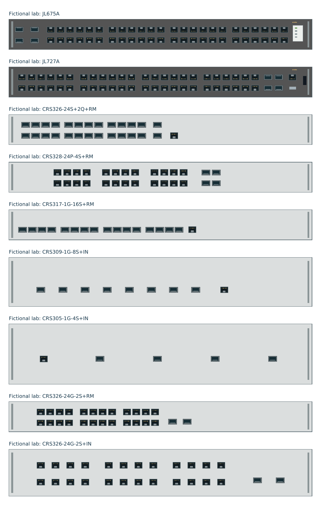

# MikroTik physical faceplates

The browser editor now draws every model recognized by the native RouterOS importer, rather than a generic switch band. This is **seven supported models**, not a claim to cover MikroTik's entire product catalog.

| Model | Front-panel organization | Manufacturer reference |
| --- | --- | --- |
| CRS326-24S+2Q+RM | Three eight-port SFP+ banks, two vertically paired QSFP+ cages, Ethernet to the right | [Product and photos](https://mikrotik.com/product/crs326_24s_2q_rm) |
| CRS328-24P-4S+RM | Three eight-port copper banks, four SFP+ sockets in two columns | [Product and photos](https://mikrotik.com/product/crs328_24p_4s_rm) |
| CRS317-1G-16S+RM | Single optical row in four four-port banks, Ethernet to the right | [Product and photos](https://mikrotik.com/product/crs317_1g_16s_rm) |
| CRS309-1G-8S+IN | Single eight-port optical row, Ethernet to the right | [Product and photos](https://mikrotik.com/product/crs309_1g_8s_in) |
| CRS305-1G-4S+IN | Ethernet on the left, four optical sockets in one row | [Product and photos](https://mikrotik.com/product/crs305_1g_4s_in) |
| CRS326-24G-2S+RM | Three eight-port copper banks, two single-row optical sockets | [Product and photos](https://mikrotik.com/product/CRS326-24G-2SplusRM) |
| CRS326-24G-2S+IN | Same logical port ordering as RM, with its own desktop case aspect and positions | [Product and photos](https://mikrotik.com/product/crs326_24g_2s_in) |

Official product photos and product dimensions were reviewed for these arrangements. These are editable schematic faceplates, not manufacturing-scale replicas. Decorative LEDs, console connectors and case details are not represented as data ports. Socket envelopes follow the application's common schematic optical size rather than asserting identical physical form-factor dimensions.

The `MIKROTIK-SHARED-` records used by native signature inference now resolve to the same geometry without being promoted to an exact SKU. QSFP lane names attach to the appropriate physical cage, not eight invented sockets. Unknown models remain unknown until a supported layout is researched; imported artwork and manual port mapping are not rewritten.

