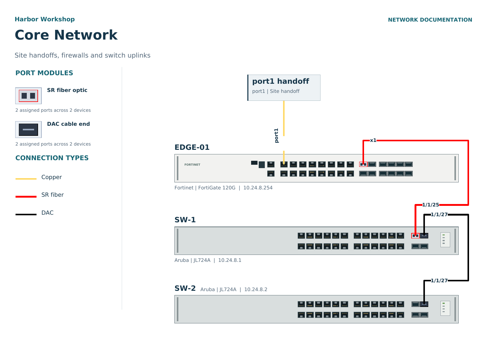
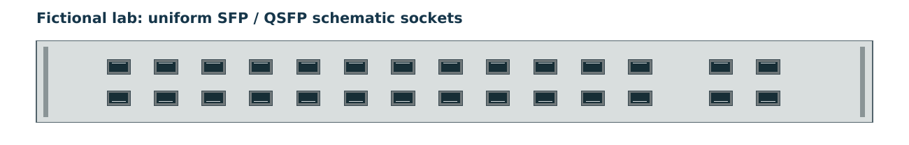

# Optical connector proportions

The built-in faceplates are schematic illustrations with standardized connector
widths. They are not engineering-scale chassis drawings. Port centers, aliases,
row orientation and connection glue remain tied to the researched device layout.
Imported manufacturer artwork keeps its own aspect ratio and mapped anchors.

## Reference and application

All built-in SFP, SFP+, SFP28, QSFP and X2 optical faces now use one schematic
size: .028 of the shared chassis width, with a 13.7:8.6 front aspect. This is
an intentionally uniform visual convention requested for readable diagrams,
not a claim that their real physical form factors are identical. Device port
metadata and capacities remain unchanged. RJ45 and copper CX4 are unchanged.
The SFP aspect is based on [INF-8074i](https://members.snia.org/document/dl/26184).

Generic installed modules use that same envelope at the host device's scale;
they no longer shrink differently according to the chassis height. Imported
artwork and explicit size edits remain authoritative. Different user-applied
device/page scales still scale the entire device, including its ports.

SVG, PDF and Visio share the scene geometry. Tests verify mixed C9500 SFP/QSFP
size equality, chassis/stack normalization, unchanged centers, generic module
size, cable endpoint glue and PDF aspect. Port-map report geometry already
uses one optical face size per common report scale.

## Rendered synthetic example

The image below is an unedited rendering of the application's PDF output using
its fictional sample site. It shows the SFP socket and installed-module shapes
alongside unchanged copper connectors, and the matching module legend.

The following actual PDF rendering exercises the mixed C9500 SFP/QSFP layout:

